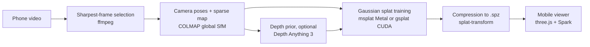

# argmin

GPS-free 3D mapping from an ordinary phone video.

Film a space with any smartphone, upload the video, and `argmin` reconstructs it as a navigable
3D scene (a 3D Gaussian splat) together with the camera trajectory. No GPS, no LiDAR and no
prior map are required.

## Motivation

Autonomous drones and robots working in mines, tunnels, warehouses and dense industrial sites
often cannot rely on satellite positioning, and they usually depend on maps or sensors that
already exist. `argmin` explores the first step of a GPS-denied workflow: build the map yourself,
from a single walk-through, using only a camera.

## How it works



1. **Frame selection.** Frames are sampled densely and the sharpest one per window is kept,
   which removes motion blur.
2. **Camera poses.** COLMAP's global mapper recovers the camera position for every frame. If too
   many frames fail to register, the pipeline retries once with ALIKED features and LightGlue
   matching and keeps the better result.
3. **Depth prior (optional, experimental).** Depth Anything 3 depth is aligned to the COLMAP
   cameras and used to seed the splat on low-texture surfaces such as blank walls.
4. **Training.** A Gaussian splat is optimised on the GPU. Two backends are supported:
   [msplat](https://github.com/rayanht/msplat) on Apple Silicon and
   [gsplat](https://github.com/nerfstudio-project/gsplat) on NVIDIA GPUs.
5. **Delivery.** The scene is compressed to roughly 5 MB and served to a phone-friendly viewer
   with orbit controls and a replay of the filmed camera path.

## Quick start

### Option A: Google Colab (free GPU, no local compute)

[](https://colab.research.google.com/github/Shreenandbhattad/argmin/blob/main/colab/room_splat.ipynb)

1. Select **Runtime, Change runtime type, T4 GPU**.
2. Run the cells in order. Setup takes about 10 to 15 minutes per session.
3. The final cell prints a link and a QR code. Open it on your phone, record or pick a video,
   and upload it.

The notebook includes cells to cancel the running job, show scene status, and reset everything.
Scenes live only for the lifetime of the Colab session.

### Option B: local, on Apple Silicon

Requirements: macOS on Apple Silicon, Python 3.10 or newer, Node.js 18 or newer, and
`brew install ffmpeg colmap`.

```sh
python3 -m venv .venv && .venv/bin/pip install -r requirements-mac.txt
npm ci                       # installs splat-transform
./start.sh                   # prints http://<your-ip>:8800
```

Open the printed address in Safari on a phone on the same Wi-Fi. To process a file directly:

```sh
mkdir -p scans/demo && cp video.mov scans/demo/input.mov
.venv/bin/python pipeline.py scans/demo/input.mov --frames 180 --iters 7000
```

Output is written to `scans/demo/` (`scene.spz`, `splat.ply`, `view.json`).

## Filming guide

Capture quality matters more than any setting.

- Record 1 to 2 minutes at 1080p or higher.
- Move slowly. Walk along the walls facing inward, then make a second pass facing the walls.
- Keep the lights on, avoid mirrors and fast rotations, and keep edges or furniture in frame
  rather than only a blank wall.
- On iOS, pick the video from the Files app. Selecting it from Photos in Safari can downscale it.

## Project layout

| Path | Purpose |
|---|---|
| `pipeline.py` | End-to-end pipeline and command-line entry point |
| `server.py` | Upload server with chunked uploads, an optional access key and a job queue |
| `export_ckpt.py` | Converts a gsplat checkpoint to a standard `.ply` |
| `da3_init.py` | Optional Depth Anything 3 depth prior aligned to COLMAP |
| `web/` | Mobile upload page and 3D viewer |
| `colab/` | Colab notebook and the script that generates it from the sources above |
| `tools/` | Experiments, such as the depth-prior A/B test |

## Results so far

Measured on an Apple M5 with 16 GB of memory.

- A 50-frame sample scene runs end to end in about 2 minutes with the local backend.
- Two phone videos (480x360) registered 342 of 348 frames and 180 of 180 frames respectively.
- Depth prior A/B on the textured sample scene, same training budget, held-out views:
  PSNR 29.60 to 29.72 dB, SSIM 0.892 to 0.893. This is a single run on a textured scene.
  The intended benefit, better coverage on blank walls, has not been demonstrated yet.

## Limitations

- **Not a metric map.** Monocular reconstruction has arbitrary scale. Navigation needs a scale
  reference (a known object or an inertial sensor).
- **Offline.** Reconstruction takes minutes on a GPU. It does not run onboard in real time.
- **Appearance-based.** Dark, dusty, featureless or highly repetitive environments (long tunnels)
  degrade pose estimation and can cause drift.
- **Static scenes only.** Moving people or machinery produce artefacts.
- **Colab backend is experimental.** The NVIDIA path has not yet been confirmed end to end on
  Colab; the local Apple Silicon path has.

## Roadmap

- Derive an obstacle map (occupancy grid or signed distance field) from the reconstruction.
- Localise a new camera frame against the stored map, giving GPS-free relocalisation.
- Plan and visualise collision-free paths inside the scene.
- Recover metric scale and evaluate drift on long, low-light trajectories.

## Acknowledgements and third-party software

`argmin` builds on the following projects. Each remains under its own license.

| Component | License |
|---|---|
| [COLMAP](https://github.com/colmap/colmap) | BSD-3-Clause |
| [msplat](https://github.com/rayanht/msplat) | Apache-2.0 |
| [gsplat](https://github.com/nerfstudio-project/gsplat) | Apache-2.0 |
| [Spark](https://github.com/sparkjsdev/spark) | MIT |
| [splat-transform](https://github.com/playcanvas/splat-transform) | MIT |
| [Depth Anything 3](https://github.com/ByteDance-Seed/Depth-Anything-3) (BASE weights) | Apache-2.0 |
| [cloudflared](https://github.com/cloudflare/cloudflared) | Apache-2.0 |

The optional Colab self-test downloads a sample from
[NVlabs/instant-ngp](https://github.com/NVlabs/instant-ngp) under that project's own terms. It is
not redistributed here.

## License

MIT. See [LICENSE](LICENSE).
